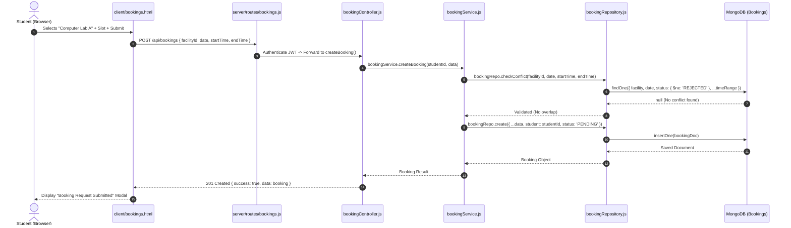
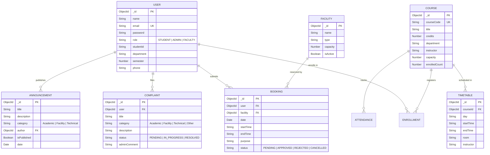

# CampusConnect 🎓
### Enterprise-Grade University Student Management & Campus Services Platform

[](https://nodejs.org/)
[](https://expressjs.com/)
[](https://www.mongodb.com/)
[](docs/architecture.md)
[](netlify.toml)
[](package.json)

> **Software Development & Architecture (SDA) Capstone Engineering Project**  
> Designed to demonstrate strict separation of concerns, enterprise architectural patterns, role-based access control (RBAC), and modern full-stack web engineering without reliance on client-side heavy Single Page Application (SPA) frameworks.

---

## 📑 Table of Contents
1. [Executive Summary & Abstract](#-executive-summary--abstract)
2. [Architectural Blueprint (Strict 4-Tier Layered Architecture)](#-architectural-blueprint)
   - [Architectural Tier Breakdown](#architectural-tier-breakdown)
   - [Request-Response Lifecycle Diagram](#request-response-lifecycle-diagram)
   - [Why Layered Architecture?](#why-layered-architecture)
3. [Key Modules & Feature Capabilities](#-key-modules--feature-capabilities)
   - [Student Experience](#1-student-experience)
   - [Faculty Portal](#2-faculty-portal)
   - [Administrative Command Center](#3-administrative-command-center)
4. [Technology Stack & Architectural Constraints](#-technology-stack--architectural-constraints)
5. [Complete Database Design & Data Models](#-complete-database-design--data-models)
   - [Entity-Relationship Diagram](#entity-relationship-diagram)
   - [Schema Specifications](#schema-specifications)
6. [Comprehensive REST API Reference](#-comprehensive-rest-api-reference)
   - [Authentication Endpoints](#1-authentication-endpoints-apiauth)
   - [Course Management Endpoints](#2-course-management-endpoints-apicourses)
   - [Facility Booking Endpoints](#3-facility-booking-endpoints-apibookings)
   - [Complaints & Support Endpoints](#4-complaints--support-endpoints-apicomplaints)
   - [Announcements Endpoints](#5-announcements-endpoints-apiannouncements)
   - [Timetable Endpoints](#6-timetable-endpoints-apitimetable)
   - [Attendance Endpoints](#7-attendance-endpoints-apiattendance)
   - [Admin Control Endpoints](#8-admin-control-endpoints-apiadmin)
7. [Repository & Directory Structure](#-repository--directory-structure)
8. [Getting Started & Local Setup](#-getting-started--local-setup)
   - [Prerequisites](#prerequisites)
   - [Installation](#installation)
   - [Environment Configuration](#environment-configuration)
   - [Running the Server](#running-the-server)
   - [Auto-Seeding & In-Memory MongoDB Fallback](#auto-seeding--in-memory-mongodb-fallback)
   - [Pre-Configured Demo Credentials](#pre-configured-demo-credentials)
9. [Deployment Architecture (Netlify Serverless + Atlas)](#-deployment-architecture)
10. [Security & Hardening Standards](#-security--hardening-standards)
11. [UI Redesign Masterplan](#-ui-redesign-masterplan)
12. [Authors & Academic Attribution](#-authors--academic-attribution)

---

## 📌 Executive Summary & Abstract

Traditional university management systems frequently suffer from monolithic code sprawl, tight coupling between user interfaces and data schemas, fragmented department portals, and high latency. 

**CampusConnect** solves this by establishing a unified, multi-tenant academic operations portal powered by a **Strict 4-Tier Layered Architecture**. It provides students, faculty members, and campus administrators with high-performance, real-time workflows for course enrollments, automated collision-free facility reservations, grievance tracking, academic timetable resolution, and multi-channel announcements.

### Core Engineering Highlights
- **Strict Layered Separation**: The Presentation tier never communicates directly with the persistence store; each request trickles strictly through Presentation Controllers, Domain Service Rules, Data Access Repositories, and Mongoose Data Models.
- **Embedded In-Memory Database Fallback**: Built-in developer experience allows running the entire application immediately via `mongodb-memory-server` without installing MongoDB locally or configuring cloud clusters beforehand.
- **Conflict Prevention Engine**: Facility scheduling and course capacity quotas are enforced through atomic transactional verification rules in the business layer.
- **Stateless RBAC Security**: Hardened using cryptographic JSON Web Tokens (JWT), salted bcrypt password hashing, and Helmet Content Security Policies.

---

## 🏗️ Architectural Blueprint

The system strictly adheres to the classical **4-Tier Layered Architecture Pattern** (Presentation, Business Logic, Data Access, and Database Layer).

```
                      +------------------------------------------+
                      |         Web Browser / Client UI          |
                      |   (HTML5 / CSS3 / Vanilla JS / jQuery)   |
                      +------------------------------------------+
                                           |
                                    HTTP / REST (JSON)
                                           v
+======================================================================================+
| 1. PRESENTATION LAYER (server/controllers & server/routes)                          |
|    - Express 5.x Routers                                                             |
|    - HTTP Request Parsing, DTO Extraction, Route-Level RBAC Middleware              |
|    - Response Serialization & HTTP Status Code Mapping                               |
+======================================================================================+
                                           |
                                Internal Function Calls
                                           v
+======================================================================================+
| 2. BUSINESS LOGIC / SERVICE LAYER (server/services)                                 |
|    - authService: Token generation, credential comparison, salt generation          |
|    - courseService: Seat quota enforcement, double-enrollment rejection              |
|    - bookingService: Time-collision detection, status life-cycle state machines     |
|    - complaintService, adminService, announcementService                             |
+======================================================================================+
                                           |
                              Data Access Contract Methods
                                           v
+======================================================================================+
| 3. DATA ACCESS LAYER / REPOSITORY PATTERN (server/repositories)                      |
|    - Decoupled data query wrappers (userRepo, courseRepo, bookingRepo, etc.)         |
|    - Single point of change if underlying DB driver or SQL/NoSQL engine changes      |
+======================================================================================+
                                           |
                                Mongoose ODM / Driver
                                           v
+======================================================================================+
| 4. DATABASE LAYER (server/models & MongoDB Atlas / MongoMemoryServer)                |
|    - Schemas with indexing, validation constraints, and timestamps                   |
|    - MongoDB Atlas Replica Set or local In-Memory Engine                             |
+======================================================================================+
```

### Architectural Tier Breakdown

| Layer | Directory | Core Technologies | Primary Responsibilities |
| :--- | :--- | :--- | :--- |
| **1. Presentation** | `client/`, `server/routes/`, `server/controllers/` | HTML5, CSS3, Bootstrap 5, Express.js Router | Renders view templates, handles browser events, validates incoming HTTP params, sends JSON payloads. Never executes DB queries. |
| **2. Business Logic** | `server/services/` | Node.js JavaScript Services | Enforces all academic business rules (e.g. max credit hours, facility time overlaps, role permissions). |
| **3. Data Access** | `server/repositories/` | Mongoose Repository Modules | Abstracts data queries away from business code. Supplies standard CRUD (`findById`, `create`, `updateStatus`, etc.). |
| **4. Database** | `server/models/`, `server/config/` | MongoDB, Mongoose ODM | Defines physical schemas, handles indexes, foreign reference relationships (`ObjectId`), and persistent storage. |

### Request-Response Lifecycle Diagram



### Why Layered Architecture?
1. **Maintainability & Modularity:** An interface redesign in `client/` requires zero changes to the business logic or database schemas.
2. **Database Agnosticism:** If MongoDB is swapped with PostgreSQL or MySQL, only the Data Access Repositories (`server/repositories/*`) need modification.
3. **Auditability & Rule Enforcement:** By routing all data mutations through central service classes, security and rule bypasses are eliminated.

---

## ⚡ Key Modules & Feature Capabilities

### 1. Student Experience
- **Authentication & Profile:** Secure login with JWT issuance, profile inspection, department and semester tracking.
- **Course Registration Engine:**
  - Real-time catalog browsing with credit counts and instructor allocation.
  - One-click enrollment with automatic seat quota decrement.
  - Drop course capability with automatic seat release.
  - Prevents duplicate enrollments or over-capacity registration.
- **Smart Facility Booking:**
  - Book campus resources: Computer Labs, Seminar Halls, Library Study Cubicles, Sports Grounds.
  - Built-in conflict prevention preventing double bookings for overlapping time intervals.
  - Real-time booking status tracking (`PENDING`, `APPROVED`, `REJECTED`, `CANCELLED`).
- **Academic Timetable:** View weekly scheduled classes, lecture halls, and assigned faculty.
- **Support & Complaints Desk:** Lodge technical or academic grievances with categorized tracking and admin responses.
- **Announcements Feed:** Instant campus broadcast stream categorised by Academic, Facility, or Technical alerts.

### 2. Faculty Portal
- **Course Roster:** View enrolled students across taught sections.
- **Attendance Management:** Record daily attendance per course and compute attendance percentages.
- **Department Announcements:** Post notices targeted to enrolled classes.

### 3. Administrative Command Center
- **Executive KPI Dashboard:** Real-time metrics tracking total students, enrolled courses, pending facility bookings, and active complaints.
- **User Directory Management:** Create, inspect, update, and remove student and faculty user records.
- **Course Administration:** Add new courses, adjust seat capacities, assign instructors, and update course metadata.
- **Booking Approval Workflow:** Review pending student reservations with single-click approval or rejection.
- **Complaint Resolution Center:** Transition tickets between statuses (`PENDING`, `IN_PROGRESS`, `RESOLVED`) and record official administrative comments.

---

## 💻 Technology Stack & Architectural Constraints

| Component | Technology | Rationale |
| :--- | :--- | :--- |
| **Client UI** | HTML5, CSS3, Bootstrap 5.3, FontAwesome 6 | Clean, responsive, glassmorphic styling without bloated framework builds. |
| **Client Scripting** | JavaScript (ES6+), jQuery 3.7 | Lightweight asynchronous AJAX queries matching academic lab requirements. |
| **Backend Runtime** | Node.js (LTS v18 - v24) | High throughput event-driven asynchronous I/O. |
| **Web Framework** | Express 5.x | Robust HTTP routing, middleware pipeline, and JSON body parsing. |
| **Database & ODM** | MongoDB Atlas & Mongoose 9.x | Flexible document schema modeling with strict type validation and timestamps. |
| **Embedded DB** | `mongodb-memory-server` | Zero-configuration local database that automatically spins up if local MongoDB is absent. |
| **Authentication** | JSON Web Tokens (`jsonwebtoken`) + `bcryptjs` | Industry-standard stateless authentication and secure salt-and-hash storage. |
| **Server Security** | `helmet`, `cors`, `express-validator` | Secure CSP headers, cross-origin resource sharing, and input sanitization. |
| **Cloud Target** | Netlify Functions (`serverless-http`) | Serverless execution ready for Netlify cloud deployment. |

*(Note: Modern frontend frameworks such as React, Angular, Vue, Next.js, and TypeScript were deliberately excluded per semester architectural specifications to emphasize raw web architecture fundamentals).*

---

## 🗄️ Complete Database Design & Data Models

### Entity-Relationship Diagram



### Schema Specifications

- **`User`**: Supports polymorphism via `role` (`STUDENT`, `ADMIN`, `FACULTY`). Stores hashed credentials, department, and academic IDs.
- **`Course`**: Enforces unique `courseCode`, credit hours (1-4), assigned instructor, and dynamic `enrolledCount` balancing.
- **`Enrollment`**: Compound index on `[student, course]` to prevent duplicate enrollments for the same semester.
- **`Facility`**: Represents physical rooms (`Computer Lab`, `Seminar Hall`, `Sports Ground`) with maximum seating capacities.
- **`Booking`**: Holds reservations with status state-machine transitions and exact time boundaries (`HH:MM`).
- **`Complaint`**: Grievance reporting tracking lifecycle states and administrative feedback logs.
- **`Timetable`**: Maps courses into weekly slots with room allocations.
- **`Attendance`**: Session-level attendance records per course and student.

---

## 📡 Comprehensive REST API Reference

All protected endpoints require an `Authorization` header containing a valid Bearer token:
```http
Authorization: Bearer <JWT_TOKEN>
```

### 1. Authentication Endpoints (`/api/auth`)

| Method | Endpoint | Access | Request Body | Description |
| :--- | :--- | :--- | :--- | :--- |
| `POST` | `/api/auth/register` | Public | `{ name, email, password, role, studentId, department, semester }` | Register a new student or faculty member |
| `POST` | `/api/auth/login` | Public | `{ email, password }` | Authenticate user and receive JWT token |
| `GET` | `/api/auth/me` | Authenticated | *None* | Get authenticated user profile details |

### 2. Course Management Endpoints (`/api/courses`)

| Method | Endpoint | Access | Request Body | Description |
| :--- | :--- | :--- | :--- | :--- |
| `GET` | `/api/courses` | Public | *None* | List all offered university courses |
| `GET` | `/api/courses/my-enrollments` | Student | *None* | List courses enrolled by the active student |
| `POST` | `/api/courses/enroll` | Student | `{ courseId }` | Enroll in a course (validates capacity) |
| `DELETE` | `/api/courses/drop/:courseId` | Student | *None* | Drop an enrolled course and release seat |
| `POST` | `/api/courses` | Admin | `{ courseCode, title, credits, department, instructor, capacity }` | Create a new course record |
| `PUT` | `/api/courses/:id` | Admin | Course metadata updates | Update course properties |
| `GET` | `/api/courses/:id/students` | Admin / Faculty | *None* | Retrieve all students enrolled in a course |

### 3. Facility Booking Endpoints (`/api/bookings`)

| Method | Endpoint | Access | Request Body | Description |
| :--- | :--- | :--- | :--- | :--- |
| `GET` | `/api/bookings/facilities` | Public | *None* | Retrieve all active bookable campus facilities |
| `GET` | `/api/bookings/my-bookings` | Student | *None* | Retrieve bookings created by current student |
| `POST` | `/api/bookings` | Student | `{ facility, date, startTime, endTime, purpose }` | Reserve a facility (verifies time conflicts) |
| `PUT` | `/api/bookings/:id/cancel` | Student | *None* | Cancel an active booking request |
| `GET` | `/api/bookings` | Admin | *None* | List all campus facility booking requests |
| `PUT` | `/api/bookings/:id/status` | Admin | `{ status: 'APPROVED' | 'REJECTED' }` | Approve or reject a facility booking |

### 4. Complaints & Support Endpoints (`/api/complaints`)

| Method | Endpoint | Access | Request Body | Description |
| :--- | :--- | :--- | :--- | :--- |
| `GET` | `/api/complaints/my-complaints` | Student | *None* | List complaints filed by current user |
| `POST` | `/api/complaints` | Student | `{ title, category, description }` | Submit a new grievance ticket |
| `GET` | `/api/complaints` | Admin | *None* | List all student complaints |
| `PUT` | `/api/complaints/:id/status` | Admin | `{ status, adminComment }` | Update complaint status & attach comment |

### 5. Announcements Endpoints (`/api/announcements`)

| Method | Endpoint | Access | Request Body | Description |
| :--- | :--- | :--- | :--- | :--- |
| `GET` | `/api/announcements` | Public | *None* | List all currently published notices |
| `GET` | `/api/announcements/all` | Admin | *None* | List all announcements (including drafts) |
| `POST` | `/api/announcements` | Admin / Faculty | `{ title, description, category, isPublished }` | Broadcast a new campus announcement |
| `DELETE` | `/api/announcements/:id` | Admin | *None* | Remove an announcement |

### 6. Timetable Endpoints (`/api/timetable`)

| Method | Endpoint | Access | Request Body | Description |
| :--- | :--- | :--- | :--- | :--- |
| `GET` | `/api/timetable` | Public | *None* | Fetch full semester academic timetable |
| `POST` | `/api/timetable` | Admin | `{ courseId, day, startTime, endTime, room, instructor }` | Assign course time slot and lecture hall |

### 7. Attendance Endpoints (`/api/attendance`)

| Method | Endpoint | Access | Request Body | Description |
| :--- | :--- | :--- | :--- | :--- |
| `POST` | `/api/attendance` | Faculty | `{ courseId, date, records: [{ studentId, status }] }` | Mark or update class attendance for a session date (idempotent) |
| `GET` | `/api/attendance/my-attendance`| Student | *None* | View personal attendance summary & percentages |
| `GET` | `/api/attendance/course/:courseId/stats` | Faculty / Admin | *None* | Aggregated attendance statistics for course section |
| `GET` | `/api/attendance/course/:courseId/date/:date` | Faculty / Admin | *None* | Retrieve existing marked attendance for a specific session date |
| `GET` | `/api/attendance/course/:courseId/history` | Faculty / Admin | *None* | Retrieve historical sessions with Present/Absent breakdown |

### 8. Admin Control Endpoints (`/api/admin`)

| Method | Endpoint | Access | Request Body | Description |
| :--- | :--- | :--- | :--- | :--- |
| `GET` | `/api/admin/stats` | Admin | *None* | Aggregated campus system KPIs and metrics |
| `GET` | `/api/admin/students` | Admin | *None* | Retrieve all registered student accounts |
| `GET` | `/api/admin/faculty` | Admin | *None* | Retrieve all registered faculty accounts |
| `PUT` | `/api/admin/users/:id` | Admin | `{ name, email, department, role }` | Modify user account attributes |
| `DELETE` | `/api/admin/users/:id` | Admin | *None* | Permanently delete user account |

---

## 📁 Repository & Directory Structure

```text
CampusConnect/
├── .env.example                  # Template environment variables
├── .gitignore                    # Git exclusions
├── netlify.toml                  # Netlify build and redirect configurations
├── package.json                  # Dependencies and npm scripts
├── README.md                     # Comprehensive system documentation (this file)
├── UI_REDESIGN_README.md         # UI/UX redesign masterplan and component ideas
│
├── client/                       # PRESENTATION LAYER: Client-side UI & Assets
│   ├── index.html                # Public Landing Page & Showcase
│   ├── login.html                # Unified Login Portal (Student/Admin/Faculty)
│   ├── dashboard.html            # Student Central Command Dashboard
│   ├── courses.html              # Course Catalog & Enrollment Console
│   ├── bookings.html             # Facility Reservation & Status Tracker
│   ├── timetable.html            # Weekly Schedule & Room Directory
│   ├── complaints.html           # Student Complaint Desk & Ticket Tracker
│   ├── announcements.html        # Campus Announcements Noticeboard
│   ├── css/
│   │   └── style.css             # Glassmorphism, animations, & typography styles
│   ├── img/
│   │   └── campus_hero.jpg       # Campus photography assets
│   ├── js/
│   │   ├── api.js                # AJAX Client Wrapper for all REST endpoints
│   │   └── auth.js               # JWT state handling, guards, & logout helpers
│   ├── admin/                    # Administrative Control Views
│   │   ├── dashboard.html        # Admin KPI Analytics & System Overview
│   │   ├── courses.html          # Course Creator & Capacity Manager
│   │   ├── bookings.html         # Facility Booking Approval Dashboard
│   │   ├── complaints.html       # Complaint Resolution Center
│   │   ├── students.html         # Student Directory Management
│   │   ├── faculty.html          # Faculty Directory Management
│   │   └── announcements.html    # Notice Broadcast Console
│   └── faculty/                  # Faculty Views
│       ├── dashboard.html        # Faculty Class Overview
│       ├── courses.html          # Course Section Roster
│       ├── attendance.html       # Daily Attendance Marker & Reports
│       └── announcements.html    # Department Notice Poster
│
├── server/                       # SERVER CORE (Strict Layered Backend)
│   ├── server.js                 # Express Application Entrypoint
│   ├── config/
│   │   └── db.js                 # MongoDB Connection + MongoMemoryServer Fallback
│   ├── middleware/
│   │   └── authMiddleware.js     # JWT Verification & Role-Based Middleware
│   ├── controllers/              # PRESENTATION LAYER (Server-side API Handlers)
│   │   ├── adminController.js
│   │   ├── announcementController.js
│   │   ├── attendanceController.js
│   │   ├── authController.js
│   │   ├── bookingController.js
│   │   ├── complaintController.js
│   │   ├── courseController.js
│   │   └── timetableController.js
│   ├── services/                 # BUSINESS LOGIC LAYER (Domain Rules)
│   │   ├── adminService.js
│   │   ├── announcementService.js
│   │   ├── authService.js
│   │   ├── bookingService.js
│   │   ├── complaintService.js
│   │   └── courseService.js
│   ├── repositories/             # DATA ACCESS LAYER (Mongoose Encapsulation)
│   │   ├── announcementRepository.js
│   │   ├── bookingRepository.js
│   │   ├── complaintRepository.js
│   │   ├── courseRepository.js
│   │   ├── enrollmentRepository.js
│   │   ├── facilityRepository.js
│   │   ├── timetableRepository.js
│   │   └── userRepository.js
│   ├── models/                   # DATABASE LAYER (Mongoose Data Schemas)
│   │   ├── Announcement.js
│   │   ├── Attendance.js
│   │   ├── Booking.js
│   │   ├── Complaint.js
│   │   ├── Course.js
│   │   ├── Enrollment.js
│   │   ├── Facility.js
│   │   ├── Timetable.js
│   │   └── User.js
│   └── routes/                   # EXPRESS ROUTING TIER
│       ├── admin.js
│       ├── announcements.js
│       ├── attendance.js
│       ├── auth.js
│       ├── bookings.js
│       ├── complaints.js
│       ├── courses.js
│       └── timetable.js
│
├── scripts/                      # Database Initialization & Seeding
│   └── seed.js                   # Populates realistic demo users, courses, & facilities
└── docs/                         # Academic Architecture Documentation
    ├── architecture.md           # Formal SDA Layered Architecture breakdown
    └── FINAL_DOCUMENTATION.md    # Complete academic project report
```

---

## 🚀 Getting Started & Local Setup

### Prerequisites
- **Node.js**: v18.0.0 or later (`node -v`)
- **npm**: v9.0.0 or later (`npm -v`)
- *(Optional)* Local MongoDB instance or MongoDB Atlas URI (An embedded database is automatically created if MongoDB is not present).

### Installation

1. **Clone or Navigate to the Workspace:**
   ```bash
   git clone https://github.com/mhamzashahidw/CampusConnect.git
   cd CampusConnect
   ```

2. **Install Dependencies:**
   ```bash
   npm install
   ```

### Environment Configuration

Create a `.env` file in the project root:
```env
PORT=5000
JWT_SECRET=super_secret_jwt_key_campusconnect_2026

# Optional: To connect to MongoDB Atlas or local MongoDB
# MONGODB_URI=mongodb+srv://<user>:<password>@cluster.mongodb.net/campusconnect
```

> **Note on Database Connectivity:**  
> If `MONGODB_URI` is omitted or points to an unavailable local port, the application automatically launches **`mongodb-memory-server`** (an embedded in-memory MongoDB engine) and automatically runs initial seeding. Zero database configuration is required to test!

### Running the Server

Start the application:
```bash
npm start
```
For auto-reloading during development:
```bash
npm run dev
```

The web application will be live immediately at:
👉 **[http://localhost:5000](http://localhost:5000)**

### Auto-Seeding & In-Memory MongoDB Fallback
If running against a standalone MongoDB instance, you can manually trigger seed data generation via:
```bash
npm run seed
```

### Pre-Configured Demo Credentials

| Role | Email | Password | Access Portal |
| :--- | :--- | :--- | :--- |
| **System Administrator** | `admin@campusconnect.edu` | `admin123` | [Admin Portal View](http://localhost:5000/login.html?role=admin) |
| **Faculty Member (Dr. Smith)** | `faculty1@campusconnect.edu` | `faculty123` | [Faculty Portal View](http://localhost:5000/login.html?role=faculty) |
| **Faculty Member (Prof. Johnson)** | `faculty2@campusconnect.edu` | `faculty123` | [Faculty Portal View](http://localhost:5000/login.html?role=faculty) |
| **Faculty Member (Dr. Lee)** | `faculty3@campusconnect.edu` | `faculty123` | [Faculty Portal View](http://localhost:5000/login.html?role=faculty) |
| **Faculty Member (Dr. Brown & Prof. Davis)** | `faculty4@campusconnect.edu`, `faculty5@campusconnect.edu` | `faculty123` | [Faculty Portal View](http://localhost:5000/login.html?role=faculty) |
| **Student (Alex Morgan - Demo #1)** | `student1@campusconnect.edu` | `student123` | [Student Portal View](http://localhost:5000/login.html) |
| **Student (Elena, Marcus ... #2 - #20)** | `student2@campusconnect.edu` ... `student20@campusconnect.edu` | `student123` | [Student Portal View](http://localhost:5000/login.html) |

---

## ☁️ Deployment Architecture

CampusConnect is pre-configured for instant zero-server deployment on **Netlify** using Serverless Functions alongside **MongoDB Atlas**.

```
[Netlify CDN (Global Edge)]
       |
       +--> Serves Client Static Assets (/index.html, /css/*, /js/*)
       |
       +--> Maps /api/* requests via netlify.toml
                 |
                 v
       [AWS Lambda / Netlify Serverless Function]
       (Wrapped by serverless-http in server/server.js)
                 |
                 v
       [MongoDB Atlas Cloud Cluster]
```

### Deployment Instructions:
1. Push your repository to GitHub.
2. In Netlify, create a **New site from Git**.
3. Configure build settings:
   - **Build command:** *(leave empty or `npm install`)*
   - **Publish directory:** `client`
   - **Functions directory:** `netlify/functions`
4. Set Environment Variables in Netlify under **Site configuration > Environment variables**:
   - `MONGODB_URI`: Your MongoDB Atlas cluster connection string
   - `JWT_SECRET`: A secure 64-character secret
5. Deploy site. The API routes will automatically execute via `/.netlify/functions/api`.

---

## 🔒 Security & Hardening Standards

1. **Password Hashing:** Passwords are cryptographically hashed using **bcrypt** with 10 salt rounds before storage in the database.
2. **Stateless Token Authentication:** User sessions are handled with cryptographically signed JSON Web Tokens (JWT) with standard expiration.
3. **Role-Based Access Control (RBAC):** Middleware (`server/middleware/authMiddleware.js`) validates token payloads and restricts administrative routes (`/api/admin/*`, course creation, booking decisions) exclusively to `ADMIN` or `FACULTY` roles.
4. **HTTP Header Protection:** `helmet` is configured to sanitize headers, guard against clickjacking (`X-Frame-Options`), and enforce Content Security Policies (CSP).
5. **Conflict Prevention:** Concurrency checks in the Business Logic layer prevent duplicate reservations or exceeding course capacity limits.

---

## 🎨 UI Redesign Masterplan

Planning a complete frontend aesthetic overhaul?  
We have created a dedicated, in-depth UI/UX design architecture document:

👉 **[Read the Complete UI Redesign Ideas & Blueprint (UI_REDESIGN_README.md)](UI_REDESIGN_README.md)**

It includes:
- **Design Systems**: Glassmorphic Neo-Academic, Slate Bento Grid, and Editorial Minimalist themes.
- **Wireframes & Layouts**: ASCII schematics for Dashboards, Course Catalog, and Booking Room Selectors.
- **Interactive Component Library**: Live credit load meters, attendance radial rings, time-slot drag selectors, and grievance Kanban boards.
- **Implementation Guide**: Micro-animations, CSS variable tokens, and recommended modern web libraries.

---

## 👥 Authors & Academic Attribution

- **Project:** CampusConnect University Portal
- **Course:** Software Development and Architecture (SDA)
- **Architecture Model:** Strict 4-Tier Layered Architecture
- **Repository:** [https://github.com/mhamzashahidw/CampusConnect](https://github.com/mhamzashahidw/CampusConnect)

*Created for academic evaluation demonstrating enterprise architecture, separation of concerns, and full-stack engineering standards.*
