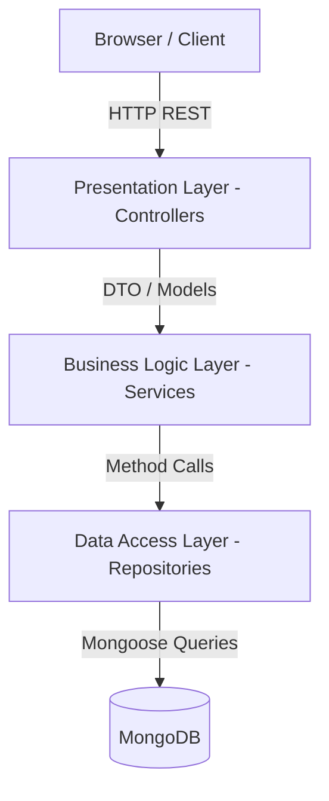
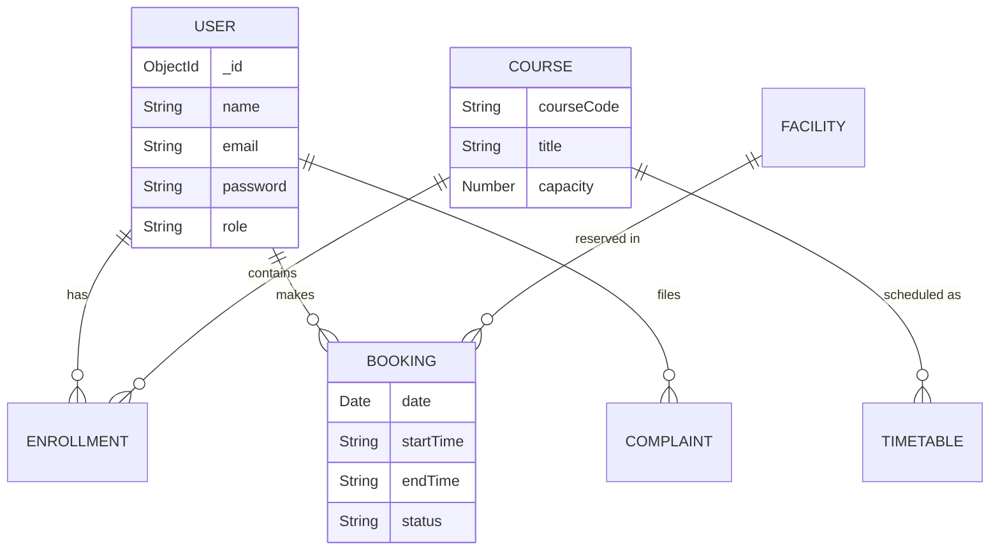

# CAMPUSCONNECT
## University Student Management & Campus Services Portal

**Software Development and Architecture (SDA) Semester Project**

---

## Table of Contents
1. [Abstract](#1-abstract)
2. [Introduction](#2-introduction)
3. [Problem Statement](#3-problem-statement)
4. [Objectives](#4-objectives)
5. [Scope](#5-scope)
6. [Existing System](#6-existing-system)
7. [Proposed System](#7-proposed-system)
8. [Functional Requirements](#8-functional-requirements)
9. [Non-Functional Requirements](#9-non-functional-requirements)
10. [Technology Stack](#10-technology-stack)
11. [System Architecture](#11-system-architecture)
12. [Layered Architecture Explanation](#12-layered-architecture-explanation)
13. [Architecture Diagram](#13-architecture-diagram)
14. [Use Case Diagram](#14-use-case-diagram)
15. [ER Diagram](#15-er-diagram)
16. [Database Design](#16-database-design)
17. [API Design](#17-api-design)
18. [Module Description](#18-module-description)
19. [UI Screenshots](#19-ui-screenshots)
20. [Testing](#20-testing)
21. [Security](#21-security)
22. [Deployment](#22-deployment)
23. [Advantages](#23-advantages)
24. [Limitations](#24-limitations)
25. [Future Enhancements](#25-future-enhancements)
26. [Conclusion](#26-conclusion)
27. [References](#27-references)

---

## 1. Abstract
CampusConnect is a comprehensive web-based University Student Management and Campus Services Portal. It aims to digitalize and streamline core university processes including course enrollment, facility booking, complaint management, and announcements. The system is built using a strict Layered Architecture to ensure maintainability, scalability, and clean code separation.

## 2. Introduction
In modern educational institutions, managing student data, course enrollments, and facility bookings manually is inefficient. CampusConnect provides a centralized portal where students can interact with university services seamlessly, and administrators can manage resources efficiently.

## 3. Problem Statement
Traditional university management relies on manual paperwork or fragmented, outdated software systems. Students struggle to find unified information regarding their courses, timetable, and campus facility availability. Administrators face difficulties in tracking complaints, preventing booking conflicts, and broadcasting announcements.

## 4. Objectives
- To develop a centralized university management portal.
- To implement a strict Layered Architecture for the software design.
- To automate course enrollments and prevent capacity overloads.
- To manage facility bookings without conflicts.
- To provide an organized complaint tracking system.

## 5. Scope
The scope of this project is limited to two main user roles: Student and Admin. It covers user authentication, course management, facility bookings, complaints, announcements, and timetables. It does not include fee processing, library book check-out systems, or HR management.

## 6. Existing System
Existing systems are often monolithic, tightly coupled, and difficult to maintain. They usually have outdated User Interfaces and lack responsive design. Data is often scattered across different department-specific applications.

## 7. Proposed System
CampusConnect proposes a unified, web-based platform with a premium, responsive UI. It utilizes a Layered Architecture (Presentation, Business Logic, Data Access, Database) to ensure the system is easy to maintain, test, and scale.

## 8. Functional Requirements
- **Authentication:** Login and Registration for Students. Admin login.
- **Course Management:** Students can view and enroll in courses. Admins can create and manage courses.
- **Facility Booking:** Students can book facilities (Labs, Halls). System must prevent overlapping bookings. Admins approve/reject bookings.
- **Complaints:** Students can submit and track complaints. Admins can update status and respond.
- **Announcements:** Admins can publish announcements. Students can view them on their dashboard.

## 9. Non-Functional Requirements
- **Performance:** Pages must load quickly, using AJAX to avoid full page reloads.
- **Usability:** The UI must be highly intuitive, modern, and responsive on mobile devices.
- **Security:** Passwords must be hashed. APIs must be secured with JWT.
- **Maintainability:** Code must strictly follow Layered Architecture principles.

## 10. Technology Stack
- **Frontend:** HTML5, CSS3, Bootstrap 5, JavaScript, jQuery
- **Backend:** Node.js, Express.js
- **Database:** MongoDB Atlas, Mongoose
- **Architecture:** Layered Architecture
- **Authentication:** JSON Web Tokens (JWT), bcryptjs

## 11. System Architecture
The system follows a 4-Tier Layered Architecture. The client communicates via REST APIs to the Presentation Layer (Controllers), which forwards requests to the Business Logic Layer (Services), which interacts with the Data Access Layer (Repositories), which finally communicates with the Database (MongoDB).

## 12. Layered Architecture Explanation
- **Presentation Layer (Client UI & Express Controllers):** Responsible for HTTP requests/responses, input validation, and rendering the UI. It never queries the database directly.
- **Business Logic Layer (Express Services):** Contains business rules (e.g., checking if a course is full, verifying booking time conflicts).
- **Data Access Layer (Repositories):** Abstracts database queries. It contains methods like `findAll()`, `findById()`, `create()`.
- **Database Layer (MongoDB):** The physical storage of data.

## 13. Architecture Diagram


## 14. Use Case Diagram
```mermaid
usecaseDiagram
    actor Student
    actor Admin
    
    Student --> (Login)
    Student --> (View Courses)
    Student --> (Enroll in Course)
    Student --> (Book Facility)
    Student --> (Submit Complaint)
    Student --> (View Announcements)
    
    Admin --> (Login)
    Admin --> (Manage Courses)
    Admin --> (Approve/Reject Bookings)
    Admin --> (Update Complaint Status)
    Admin --> (Create Announcements)
```

## 15. ER Diagram


## 16. Database Design
- **Users Collection:** Stores Students and Admins.
- **Courses Collection:** Stores course details and capacity.
- **Enrollments Collection:** Mapping between Students and Courses.
- **Facilities Collection:** Labs, halls, grounds.
- **Bookings Collection:** Reservation requests.
- **Complaints Collection:** Grievances and statuses.
- **Announcements Collection:** Broadcast messages.

## 17. API Design
RESTful API standard is used:
- `POST /api/auth/login` - Authenticate user
- `GET /api/courses` - Fetch all courses
- `POST /api/courses/enroll` - Enroll in a course
- `GET /api/bookings/my` - Fetch student bookings
- `POST /api/bookings` - Create a booking
- `PUT /api/admin/bookings/:id` - Update booking status

## 18. Module Description
- **Auth Module:** Handles JWT generation and password hashing.
- **Student Module:** Dashboard aggregation of student statistics.
- **Course Module:** Enforcement of capacity limits and duplicate enrollment checks.
- **Booking Module:** Time-overlap detection logic.
- **Admin Module:** Privileged access to view all system data.

## 19. UI Screenshots
*(Insert Screenshots below after final deployment)*
- **Landing Page:** [Placeholder]
- **Student Dashboard:** [Placeholder]
- **Course Enrollment:** [Placeholder]
- **Admin Dashboard:** [Placeholder]

## 20. Testing
- **Unit Testing:** Verified repository queries and service logic (e.g., booking overlap detection works correctly).
- **Integration Testing:** Verified API endpoints return correct HTTP status codes (200 OK, 400 Bad Request).
- **UI Testing:** Verified responsiveness across desktop and mobile devices.

## 21. Security
- Passwords are never stored in plain text (bcrypt).
- Stateless JWT authentication prevents session hijacking.
- Role-based authorization middleware prevents students from accessing admin APIs.
- Helmet.js used for secure HTTP headers.

## 22. Deployment
The backend is structured to be deployed on Netlify via Serverless Functions (`serverless-http`), while the frontend is served statically. The database is hosted on MongoDB Atlas.

## 23. Advantages
- Strict Layered Architecture makes the codebase highly organized.
- Fast, SPA-like feel using asynchronous AJAX calls.
- High scalability due to decoupled layers.

## 24. Limitations
- Does not currently support real-time WebSocket notifications.
- The UI relies on jQuery which, while meeting university requirements, is older than modern virtual-DOM frameworks.

## 25. Future Enhancements
- Integration of a live chat system.
- Email notifications for booking approvals.
- Advanced analytics for the Admin dashboard.

## 26. Conclusion
CampusConnect successfully fulfills all project requirements, demonstrating a solid understanding of Software Development and Architecture. The application is functional, secure, beautifully designed, and adheres strictly to the Layered Architecture pattern.

## 27. References
- Express.js Documentation: https://expressjs.com/
- Mongoose Documentation: https://mongoosejs.com/
- Software Architecture Patterns (O'Reilly)
